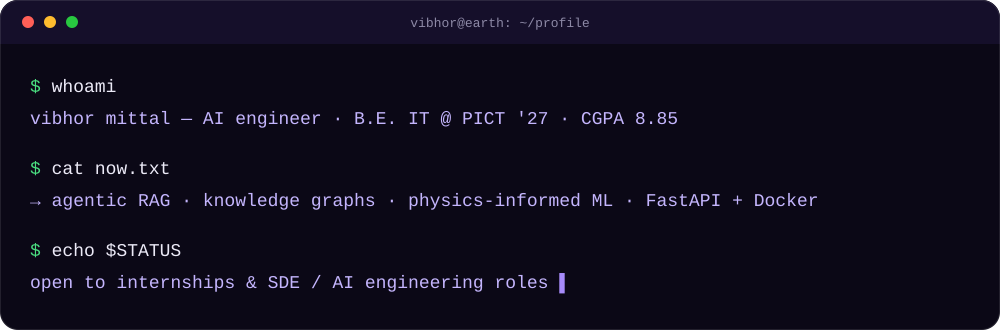
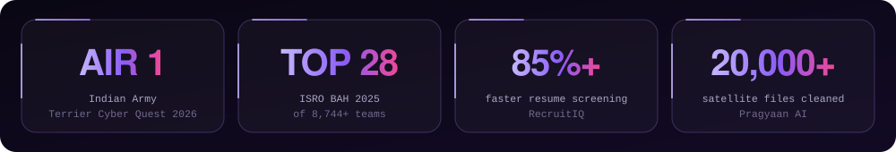

 

 

 

<h3>// receipts</h3>

Also: Finalist at IIT Bombay <b>ResCon'25</b> &amp; <b>Aarohan'25</b> · <b>McKinsey Forward</b> Program · 10 Anthropic certifications

 

<h3>// how I build</h3>

I treat AI as a **systems problem, not just a modeling task**. A notebook that scores well isn't a product — retrieval, reasoning, orchestration, evaluation and deployment have to work together. That's why most of my projects grow into full-stack intelligent architectures instead of isolated models.

 

<h3>// featured work</h3>

<table>
<tr>
<td width="50%" valign="top">

**🛰️ Pragyaan AI** · *ISRO BAH'25 · Top 28 of 8,744+ teams* 
Satellite-based PM2.5 estimation & forecasting from INSAT-3D imagery. Led the team as **Team Lead**.
- Cleaned & validated **20,000+ satellite files**, cutting preprocessing runtime **~70%**
- Physics-informed NNs + XGBoost, GPR, TFT, ConvLSTM — validated with MAE/RMSE

</td>
<td width="50%" valign="top">

**🔐 NeuroAuth** · *Finalist · ResCon'25, IIT Bombay* 
Continuous authentication & fraud detection from keystroke, touch and motion behavior — stops session hijacking.
- FastAPI backend (TLS 1.3, AES-256) handling **100+ behavioral signals** per session
- LSTM / GRU / Autoencoders / XGBoost risk scoring

</td>
</tr>
<tr>
<td width="50%" valign="top">

**🧠 RecruitIQ** · *InfoBeans internship* 
Agentic resume-intelligence system: RAG, semantic search and knowledge graphs for evidence-backed screening.
- Screening time down **85%+** (15–20 min → under 2 min per resume)
- **100+ resumes** ingested concurrently; pipeline latency down **~35%**

</td>
<td width="50%" valign="top">

**🏗️ InfraStack** · *Independent engineering project* 
Production-inspired backend systems: semantic search, real-time analytics and event-driven pipelines.
- PostgreSQL + **pgvector** search service
- Redis URL shortener with live clicks via **Pub/Sub + SSE**; RabbitMQ order pipeline; Jenkins CI/CD

</td>
</tr>
</table>

Full write-ups, photos and live demos → <a href="https://vibhor2608.github.io/portfolio/"><b>vibhor2608.github.io/portfolio</b></a>

 

<h3>// stack</h3>

  

 

<table>
<tr>
<td width="33%" valign="top">

**🔭 Currently building**
- Advanced **RAG pipelines** — semantic retrieval, vector DBs, knowledge graphs
- **Agentic systems** with LangGraph & CrewAI
- **Physics-informed ML** for satellite-based environmental intelligence
- Scalable AI backends (FastAPI, Docker)

</td>
<td width="33%" valign="top">

**🤝 Open to collaborate on**
- LLM systems & agent architectures
- AI + climate tech / remote sensing
- Knowledge graphs + semantic intelligence
- AI that needs **strong architecture, not just modeling**

</td>
<td width="33%" valign="top">

**🌱 Currently exploring**
- Agentic reasoning & LLM orchestration patterns
- LLM evaluation & observability (LangSmith)
- Enterprise-scale AI system design
- Spatio-temporal modeling

</td>
</tr>
</table>

 

<h3>// activity</h3>

 

<picture>
  <source media="(prefers-color-scheme: dark)" srcset="https://raw.githubusercontent.com/vibhor2608/vibhor2608/output/snake-dark.svg"/>
  
</picture>

 

<b>💬 Ask me about</b>

 

- **RAG vs fine-tuning vs agents** — practical trade-offs
- Designing AI systems that go **beyond notebooks**
- Knowledge graph + LLM integration
- Hackathons, system design and high-pressure problem solving

 

⚡ Fun fact — I debug AI pipelines for fun and make content for the internet. Both need a good hook. ✦
  
<a href="mailto:vibhormittal26@gmail.com"><b>Let's build something intelligent →</b></a>

